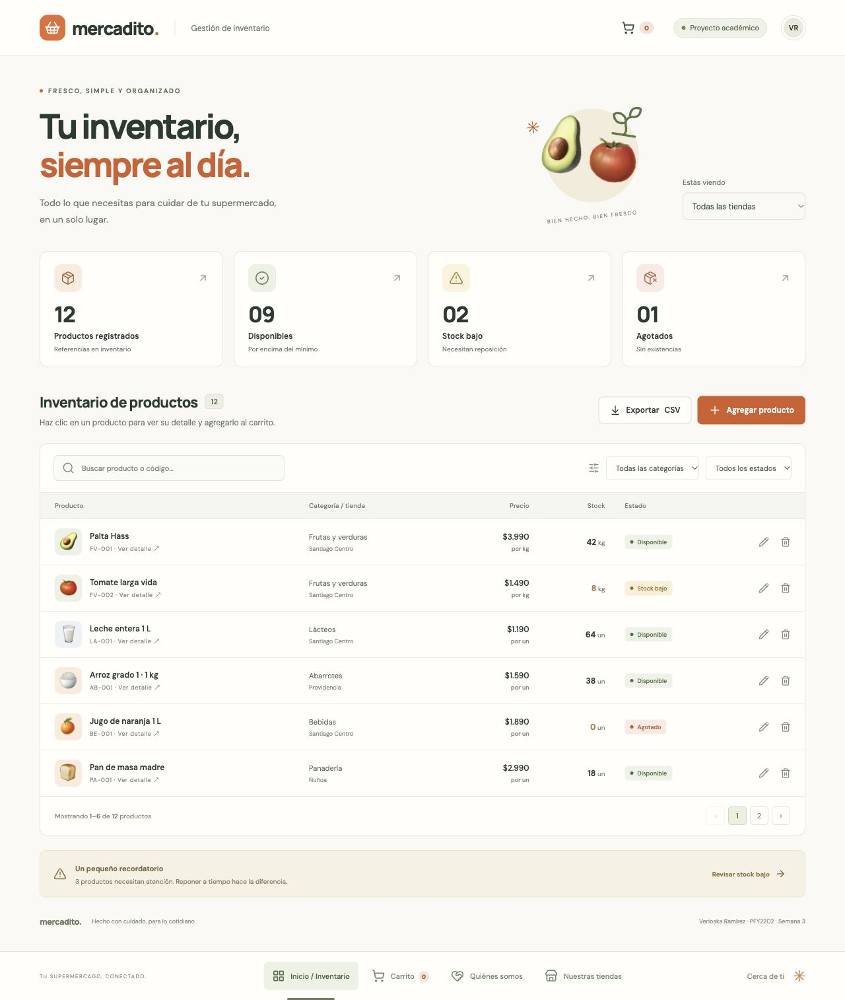
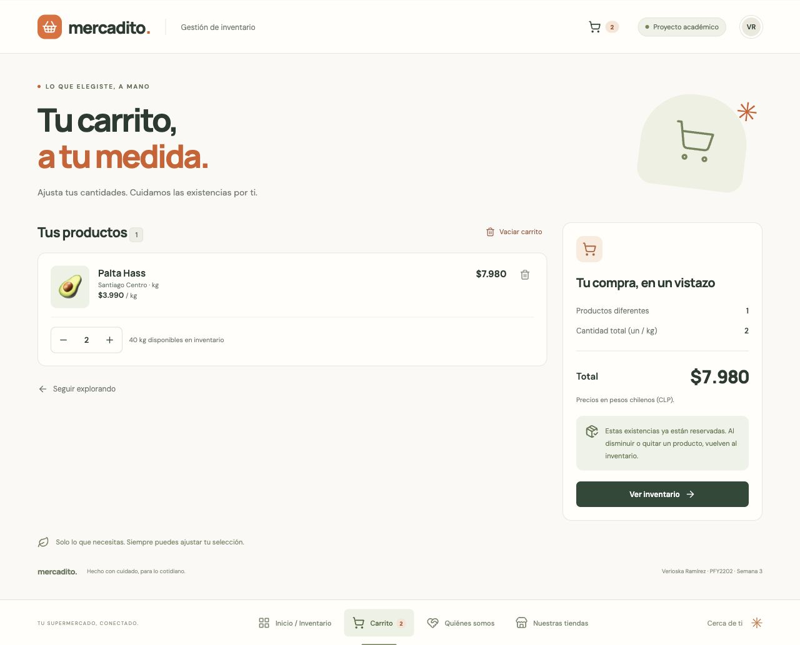
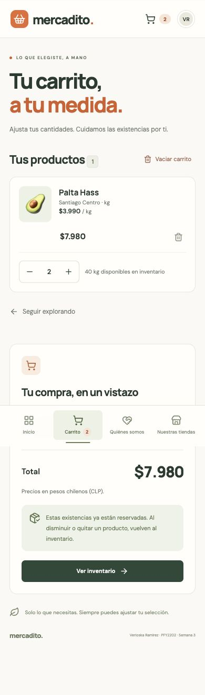

# Mercadito · React avanzado

Actividad sumativa individual, **Semana 3: Desarrollando sitios web con React avanzado**.

**Autora:** Verioska Ramírez · **Asignatura:** Desarrollo Frontend II · **Sigla:** PFY2202.

**Repositorio de entrega:** [supermercado-verioska-ramirez-PFY2202](https://github.com/verioska/supermercado-verioska-ramirez-PFY2202).

Continuación del proyecto anterior de gestión de inventario de un supermercado. Mantiene el alta, listado, edición, eliminación y exportación de artículos, junto con las páginas de información y tiendas. Agrega detalle de productos y carrito con existencias sincronizadas y estilos con Tailwind CSS.

## Ejecutar

Usa **Node.js 24**, indicado en `.nvmrc`. También se admite Node 20.19+ o 22.12+. Node 18 y anteriores no son compatibles con esta versión de Vite.

```bash
# Si utilizas nvm:
nvm install
nvm use

npm ci
npm run dev
```

Abre la dirección que muestre Vite, normalmente `http://127.0.0.1:5173/`.

```bash
npm test          # Pruebas de inventario, carrito y persistencia
npm run build    # Genera la compilación de producción en dist/
npm run preview  # Sirve la compilación de producción
```

## Requerimientos de la actividad

| Requerimiento | Implementación | Dónde comprobarlo |
| --- | --- | --- |
| Agregar y listar artículos | Formulario validado, códigos únicos por tienda y tabla paginada | Inicio → Agregar producto |
| Filtrar por categoría sin perder datos | `useState` conserva la selección; `useMemo` deriva la lista mediante `filterProducts`, sin modificar el inventario original | Inicio → Todas las categorías |
| Ver detalle al hacer clic | Nombre, categoría, código, tienda, precio, unidad y existencias | Clic en el nombre o miniatura de un producto |
| Agregar al carrito y descontar stock | Una transición de `useReducer` actualiza inventario y carrito conjuntamente | Detalle → Cantidad → Agregar al carrito |
| Nueva pantalla de carrito | Artículos, precios, subtotales, cantidades y total en CLP | Menú inferior → Carrito |
| Aumentar y disminuir cantidades | Los botones `+` y `−` reservan o devuelven existencias inmediatamente | Carrito → Control de cantidad |
| Framework CSS | Tailwind CSS 4 con el plugin oficial de Vite y utilidades en las nuevas pantallas | `vite.config.js`, `src/styles.css`, detalle y carrito |

## Pantallas

| Ruta | Contenido |
| --- | --- |
| `/` | Inventario, alta/edición, filtros, resumen y exportación CSV |
| `/productos/:id` | Detalle y selección de cantidad para agregar al carrito |
| `/carrito` | Artículos reservados, controles de cantidad, eliminación y total |
| `/nosotros` | Quiénes somos |
| `/tiendas` | Sucursales ilustrativas y horarios |
| Cualquier otra | Página no encontrada |

La navegación utiliza React Router y conserva el estado sin recargar. Los enlaces de carrito muestran la cantidad total seleccionada. Un identificador inexistente muestra un mensaje y un enlace para volver.

## React avanzado y organización

`InventoryProvider` comparte el inventario y carrito mediante **Context API** y el hook propio **`useInventory`**. **`useReducer`** centraliza las transiciones y cambia ambos conjuntos en una sola acción. **`useMemo`** deriva filtros y artículos del carrito; **`useEffect`** guarda los datos y gestiona navegación y foco; **`useRef`** controla diálogos y notificaciones.

```text
src/
  App.jsx                         Rutas, navegación y notificaciones
  main.jsx                        BrowserRouter e InventoryProvider
  data.js                         Productos, categorías y tiendas de ejemplo
  inventory.js                    Validación, búsqueda, filtros, stock y CSV
  shop.js                         Reducer, reservas y carga de datos
  context/InventoryContext.jsx    Estado compartido y persistencia
  components/
    ProductDialog.jsx             Formulario de alta y edición
    QuantityControl.jsx           Control de cantidad reutilizable
  pages/
    Home.jsx                      Inventario y filtros
    ProductDetail.jsx             Detalle y reserva de productos
    Cart.jsx                      Gestión del carrito
    About.jsx                     Quiénes somos
    Stores.jsx                    Nuestras tiendas
  styles.css                      Tailwind y estilos originales
  shop.css                        Complementos visuales de detalle y carrito
tests/
  inventory.test.js               Reglas del inventario original
  shop.test.js                    Reservas, devoluciones y persistencia
docs/capturas/                    Evidencias visuales
```

Tailwind genera CSS durante la compilación; no depende de un CDN. Se importan su tema y utilidades sin Preflight para conservar los estilos anteriores. Las nuevas pantallas usan utilidades para grillas adaptables, espaciados, tipografía y alineación.

## Reglas de inventario y carrito

- El **stock disponible** es lo que todavía se puede agregar. Las cantidades del carrito ya están descontadas.
- Agregar o aumentar cantidades reduce las existencias. No se pueden superar ni reservar productos agotados.
- Disminuir cantidades devuelve la diferencia al inventario. Disminuir de uno a cero quita la línea y devuelve la última existencia.
- Quitar un producto o vaciar el carrito devuelve las cantidades correspondientes. Agregar el mismo artículo acumula la cantidad en una sola línea.
- Los productos se venden por unidad o por kilogramo. Para esta actividad los kilogramos se seleccionan como enteros. Los importes se muestran en pesos chilenos.
- Subtotales y total se calculan con los precios actuales del inventario; una edición de precio se refleja también en el carrito.
- No se puede eliminar un producto reservado ni cambiar su tienda o unidad hasta retirarlo del carrito. Sí se pueden actualizar sus demás datos y el stock disponible, manteniendo las reservas.
- El stock disponible más lo reservado no puede superar 1.000.000 por producto, para permitir la devolución de todas las existencias.

**Ejemplo:** Palta Hass comienza con **42 kg**. Agregar **2 kg** deja **40 kg** y un subtotal de **$7.980**. Aumentar a **3 kg** deja **39 kg** y **$11.970**. Volver a dos restaura **40 kg**; vaciar el carrito devuelve los **42 kg**.

## Persistencia

Inventario y carrito se guardan **juntos** en `localStorage` con la clave `mercadito-shop-v2`. Al recargar se restauran las reservas y el stock descontado, sin volver a descontarlo. Si existe el inventario anterior (`mercadito-inventory-v1`) en el mismo navegador y origen, se migra automáticamente y se inicia un carrito vacío.

Se validan los datos guardados, incluyendo referencias y cantidades del carrito. Si están corruptos, se cargan los ejemplos con un aviso. Si el almacenamiento está bloqueado o lleno, los cambios permanecen en la sesión y se informa que no se pueden guardar.

## Guion para presentar y comprobar

1. En el inicio con los datos de ejemplo se muestran **12 productos**.
2. Selecciona **Lácteos**: aparecen dos. Vuelve a **Todas las categorías** y comprueba que siguen los 12 originales.
3. Abre **Palta Hass** y comprueba los **42 kg** y el precio de **$3.990/kg**.
4. Selecciona dos y agrega al carrito: aparecen **40 kg** disponibles y **$7.980** en el carrito.
5. Aumenta a tres y luego disminuye a dos. Comprueba los cambios siguiendo el ejemplo anterior.
6. Recarga: deben mantenerse los dos kg reservados y los 40 disponibles.
7. Vacía el carrito y vuelve al inventario: se restauran los **42 kg**.
8. Abre **Jugo de naranja 1 L**, inicialmente agotado. Se muestra el aviso y no se ofrece agregar al carrito.
9. Agrega un producto con stock 1. Resérvalo: no se puede aumentar su cantidad. Disminuye a cero y comprueba que el stock vuelve a 1.
10. Revisa escritorio y móvil, navegación con Tab y diálogos de alta/edición.

Las pruebas automatizadas verifican filtros sin mutación, acumulación de reservas, incrementos, decrementos, eliminación, vaciado, stock insuficiente, cantidades inválidas, edición de productos reservados, límites, datos corruptos y migración del almacenamiento.

## Evidencias visuales

### Inventario



### Carrito



### Vista móvil



## Entrega en GitHub

El repositorio existente cumple el formato solicitado: **`supermercado-verioska-ramirez-PFY2202`**. Esta carpeta continúa su historial. La carpeta del proyecto anterior se conserva por separado.

Para publicar cambios futuros desde esta carpeta:

```bash
git status
git add .
git commit -m "Actualiza la actividad sumativa de React avanzado"
git push origin main
```

Comparte con tu docente la URL indicada al inicio. La entrega solicitada es el código en GitHub; no es necesario publicar el sitio en GitHub Pages. `.gitignore` excluye `node_modules`, `dist`, archivos de entorno y credenciales. Se incluye `package-lock.json` para instalar las versiones verificadas con `npm ci`.

Para otro alojamiento estático, configura una reescritura hacia `index.html` para las rutas de React Router. GitHub Pages requiere adaptar rutas y base antes de desplegar allí.

## Alcance

Mercadito es una marca ficticia. Productos, existencias, tiendas, direcciones y horarios son ilustrativos. La aplicación funciona en el navegador, sin backend, autenticación ni pasarela de pago. El carrito reserva existencias localmente; la actividad no solicita un proceso de pago. Cada navegador y origen mantiene sus datos. Las fuentes de Google Fonts cuentan con respaldo local.

## Referencias

- [React: useReducer](https://react.dev/reference/react/useReducer)
- [React: useContext](https://react.dev/reference/react/useContext)
- [React: useMemo](https://react.dev/reference/react/useMemo)
- [React Router](https://reactrouter.com/start/declarative/installation)
- [Tailwind CSS: instalación con Vite](https://tailwindcss.com/docs/installation/using-vite)
- [Vite](https://vite.dev/guide/)
